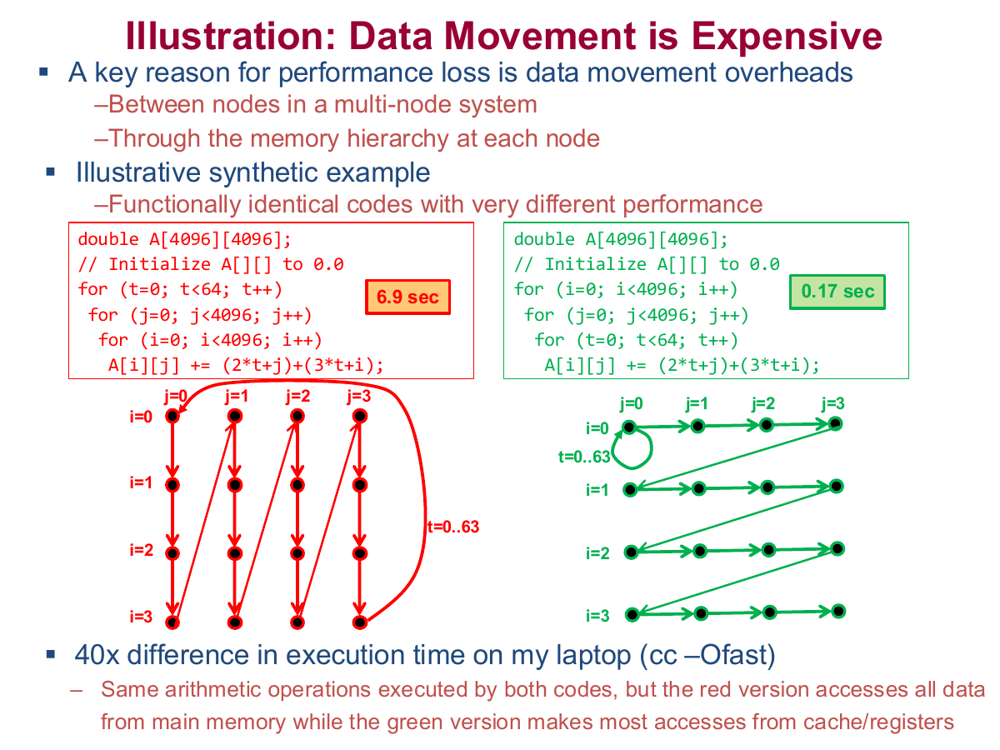
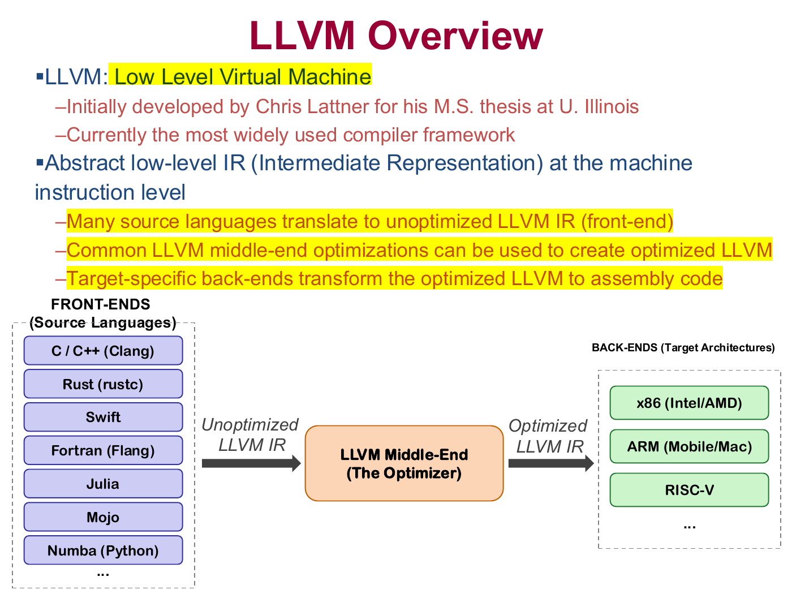
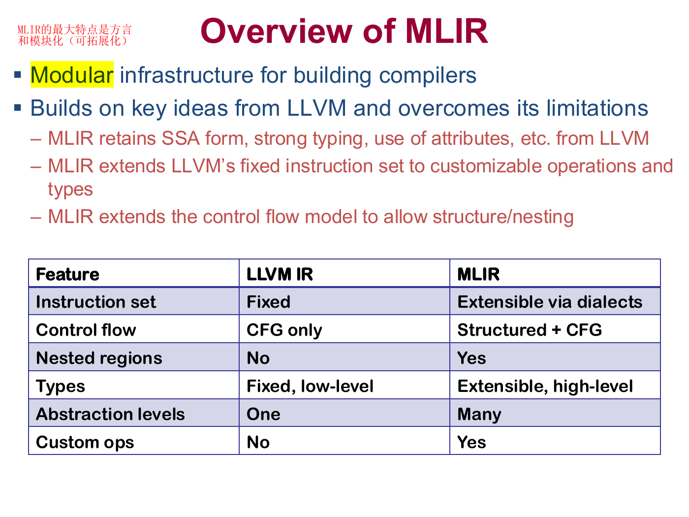
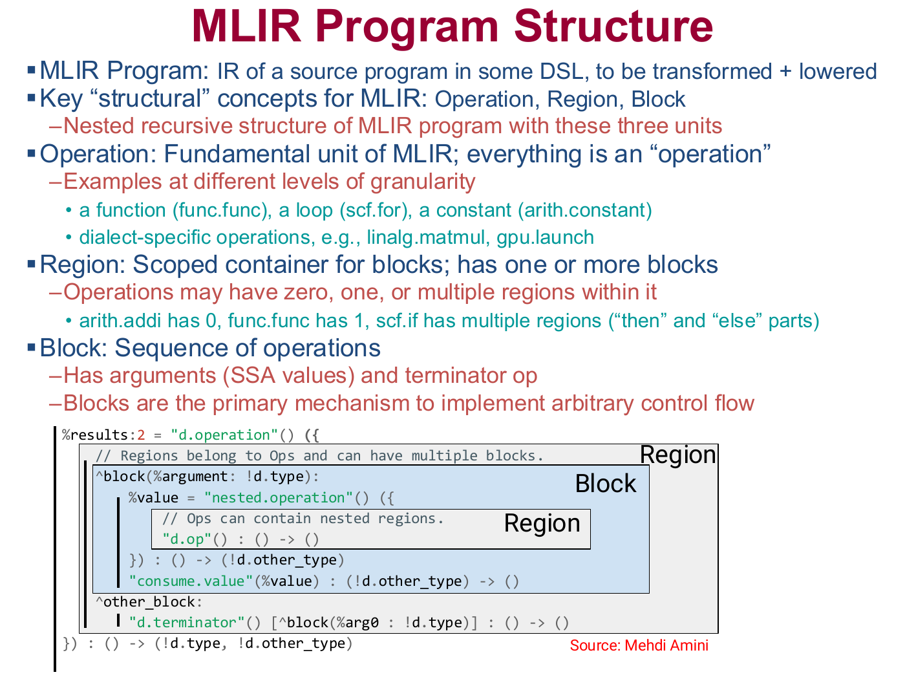
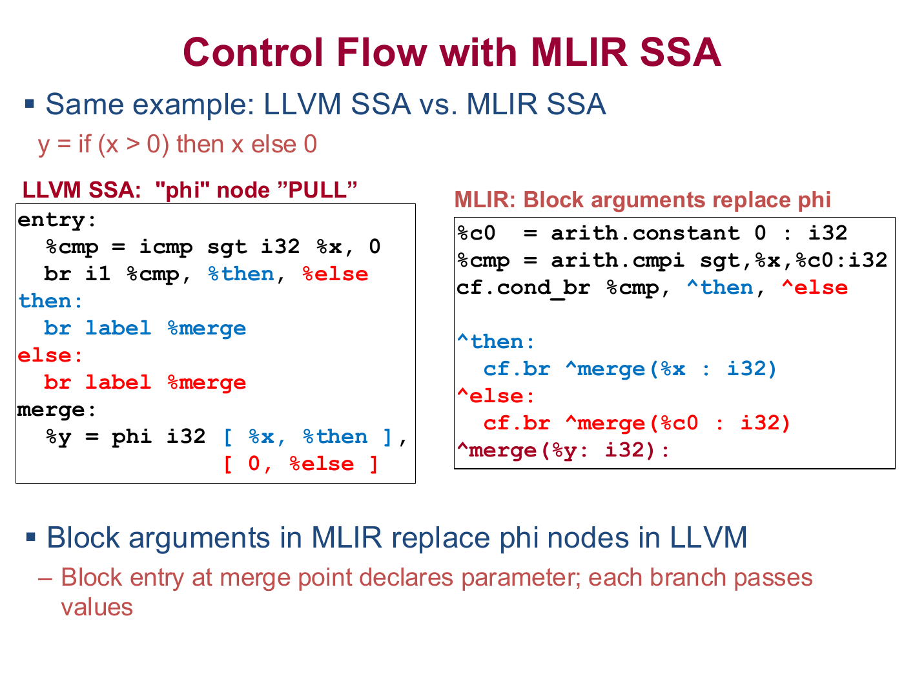

# Lec 01：编译器、LLVM 与 MLIR 入门

> 本讲义根据 `D01-S02-CompilerIntroduction.pdf` 全部 26 页内容整理，并加入面向初学者的解释、代码示例、术语释义和知识拓展。
>
> 学习目标：读完后，你应该能够回答以下问题：
>
> - 编译器到底在做什么，为什么需要中间表示（IR）？
> - 为什么“程序更快”不只是减少算术指令，还和缓存、数据移动、流水线、向量化有关？
> - LLVM 是什么？前端、中端、后端分别负责什么？
> - 什么是 LLVM IR、SSA、基本块、`phi` 节点？
> - MLIR 为什么在 LLVM 之上引入多个层级和 dialect？
> - MLIR 中的 operation、region、block 是什么关系？

## 1. 全局地图：从源代码到硬件

先建立一张总图。一个现代编译器通常把源程序逐步转换为越来越接近目标硬件的表示：

```text
高级源语言
  C/C++、Rust、Fortran、Swift、Julia、Python DSL、张量程序
        |
        v
前端：词法/语法/语义分析，构造 AST 或高级 IR
        |
        v
中间表示 IR
        |
        +--> 分析：控制流、数据流、依赖、别名、类型、内存访问
        |
        +--> 优化：常量传播、公共子表达式消除、循环变换、向量化……
        |
        v
低层 IR，例如 LLVM IR
        |
        v
后端：指令选择、寄存器分配、指令调度、汇编生成
        |
        v
目标文件、汇编代码、机器码
        |
        v
链接器处理后得到可执行文件或库
```

这不是“一次翻译”，而是很多个 **pass（编译器遍）** 依次对程序进行变换。每个 pass 通常完成一个相对明确的任务，例如：

- 把语法树转换成某种 IR；
- 删除永远不会执行的代码；
- 把常量计算提前到编译期；
- 改变循环顺序以减少缓存未命中；
- 把标量操作合并成向量操作；
- 把高层矩阵乘法降低为循环，再降低为加载、乘法、加法和跳转；
- 根据目标 CPU 的指令集生成机器指令。

编译器的两个基本职责是：

1. **保持语义**：编译后的程序应该和源程序表达同样的行为，除非语言规则或编译选项明确允许改变某些行为。
2. **提高执行质量**：在不改变语义的前提下，减少时间、能耗、内存占用或数据移动开销。

## 2. 什么是编译器

### 2.1 编译器的定义

编译器（compiler）是一类程序转换工具。它把程序员使用的高级语言转换成目标处理器可以执行的低级指令。

例如：

```c
for (int i = 0; i < n; i++) {
    a[i] = s * a[i] + a[i];
}
```

这段代码表达的是一个循环和数组计算。目标处理器最终执行的可能是类似下面的指令序列：

```asm
vmovaps (%r11,%rax), %ymm0
vmulps  %ymm2, %ymm0, %ymm1
vaddps  %ymm1, %ymm0, %ymm0
vmovaps %ymm0, (%r11,%rax)
addq    $32, %rax
```

这些指令使用了 x86 的 AVX 向量寄存器，一条指令可以同时处理多个数据元素。源代码和汇编代码看起来差异很大，但它们表示的是同一个计算。

### 2.2 为什么中间表示很重要

如果每种源语言都直接生成每种处理器的机器码，编译器实现会变得非常复杂。例如有 4 种语言和 5 种处理器时，直接组合就可能需要维护 20 条代码生成路径。

更常见的工程结构是：

```text
C/C++      \
Rust       \
Fortran     ---> 统一 IR ---> 通用优化 ---> 不同目标后端
Swift      /
其他语言   /
```

中间表示（Intermediate Representation，IR）有三个重要作用：

- **解耦**：前端主要处理语言，后端主要处理硬件；
- **分析**：IR 比源代码更规范，比机器码更容易分析；
- **复用**：同一套优化和代码生成组件可以服务多种语言。

### 2.3 编译器的“降低”与“优化”

PDF 中使用了 **lowering（降低）** 这个概念。降低不是简单地“把代码翻译成更长的代码”，而是把高层结构逐步展开成低层结构。

例如：

```text
矩阵乘法
  -> 三重循环
  -> 分块循环
  -> 内存加载、乘法、加法
  -> 目标机器的向量指令
```

在降低过程中，编译器也会进行优化。典型优化目标包括：

- 减少执行的指令数量；
- 减少昂贵的内存访问；
- 提高指令吞吐率；
- 增加缓存和寄存器中的数据复用；
- 利用向量、矩阵或并行硬件；
- 减少处理器之间或内存层次之间的数据移动。

## 3. 计算系统的核心挑战

PDF 的前半部分强调一个事实：现代计算的难点往往不是“如何写出一个能运行的算法”，而是同时做到：

```text
生产力（Productivity）
性能（Performance）
可移植性（Portability）
```

### 3.1 生产力：高性能代码很难写

要让程序跑得快，开发者可能需要了解：

- CPU 的缓存层次；
- SIMD 向量指令；
- GPU 的线程组织；
- 内存访问是否连续；
- 数据布局；
- 处理器之间的通信；
- 指令延迟和吞吐量；
- 哪些操作可以并行；
- 哪些数据之间存在依赖。

这意味着，开发者不仅要懂算法，还要懂目标硬件的细节。

### 3.2 性能：最优实现很难推导

即使开发者熟悉硬件，也很难手工找到全局最优实现，因为很多因素相互影响：

- 改变循环顺序可能改善缓存访问，但也可能影响并行性；
- 循环展开可能提高吞吐率，但会增大代码体积；
- 算子融合可能减少内存访问，但增加寄存器压力；
- 向量化可能提高算术吞吐率，但要求数据布局和依赖关系合适；
- 分块大小需要匹配缓存或片上存储容量；
- 不同 CPU、GPU 或加速器的最佳选择不同。

### 3.3 可移植性：不同硬件需要不同策略

同一个算法可能运行在：

- CPU；
- GPU；
- 空间阵列或专用加速器；
- 多节点集群；
- TPU、NPU 等 AI 加速器。

不同硬件的编程模型和性能瓶颈不一样。即使都叫 GPU，NVIDIA Ampere、Hopper、Blackwell 也可能需要不同的调优策略。

### 3.4 为什么编译器不能自动解决所有问题

PDF 给出了两个关键原因。

#### 原因一：依赖信息难以精确获得

优化器需要知道数据和控制之间的依赖关系。以 C/C++ 为例，指针可能指向重叠的内存区域：

```c
void update(float *a, float *b, int n) {
    for (int i = 0; i < n; i++) {
        a[i] = b[i] + 1.0f;
    }
}
```

如果 `a` 和 `b` 指向重叠区域，编译器不能随便重排或并行化访问；如果能确定它们不重叠，优化空间就更大。

```c
void update(float *restrict a,
            const float *restrict b,
            int n) {
    for (int i = 0; i < n; i++) {
        a[i] = b[i] + 1.0f;
    }
}
```

`restrict` 可以向编译器提供一定的别名信息，但实际工程中，所有依赖关系并不总能被静态推断出来。

#### 原因二：数据移动通常比算术更昂贵

从寄存器、缓存、主存或另一台机器搬运数据，可能比执行一次加法或乘法花费更多时间和能量。于是“把数据放在哪里、如何复用、什么时候搬运”往往比“做多少次乘法”更决定性能。

因此，面向特定领域的语言和编译器（例如张量、线性代数、GPU 或专用加速器 DSL）更有机会让程序员表达足够的高层信息，再由编译器完成系统化优化。

## 4. 数据移动为什么昂贵

### 4.1 一个直观例子

下面两个程序执行的算术操作相同，只是循环顺序不同：

```c
double A[4096][4096];

// 版本一：t -> j -> i
for (int t = 0; t < 64; t++) {
    for (int j = 0; j < 4096; j++) {
        for (int i = 0; i < 4096; i++) {
            A[i][j] += (2 * t + j) + (3 * t + i);
        }
    }
}
```

```c
double A[4096][4096];

// 版本二：i -> j -> t
for (int i = 0; i < 4096; i++) {
    for (int j = 0; j < 4096; j++) {
        for (int t = 0; t < 64; t++) {
            A[i][j] += (2 * t + j) + (3 * t + i);
        }
    }
}
```

这两个版本数学上等价，但在典型的行主序数组布局下，访问行为差别很大。PDF 中给出的示例测量约为：

```text
版本一：约 6.9 秒
版本二：约 0.17 秒
```

这不是因为版本二少做了很多加法，而是因为版本二更可能让同一个 `A[i][j]` 在寄存器或缓存中被重复使用；版本一则会在外层循环变化时反复穿过大数组，导致大量缓存未命中和主存访问。



### 4.2 局部性

缓存优化主要利用两类局部性：

- **时间局部性**：最近访问过的数据很可能很快再次被访问；
- **空间局部性**：访问一个地址后，附近连续地址的数据也可能很快被访问。

连续访问通常更容易利用缓存行和多 bank 内存：

```c
// 通常具有较好的空间局部性
for (int i = 0; i < n; i++) {
    sum += a[i];
}
```

```c
// 对行主序二维数组而言，跨行跳跃，局部性可能较差
for (int j = 0; j < n; j++) {
    sum += matrix[j][column];
}
```

实际效果还与数组布局、缓存大小、预取器和编译器优化有关，但“访问连续数据更容易高效”是重要的入门原则。

## 5. 性能模型：算术单元、存储和网络

PDF 将硬件组件概括为三类。

### 5.1 算术功能单元 AFU

Arithmetic Functional Unit（AFU）是实际执行计算的地方，可能包括：

- 标量算术单元；
- 向量/SIMD 单元；
- 矩阵乘加单元；
- GPU 中的大量并行计算单元。

### 5.2 存储组件

数据可能位于不同层级：

```text
寄存器
  -> L1 Cache
  -> L2 Cache
  -> L3 Cache
  -> 片上 scratchpad / shared memory
  -> 主存
  -> 非易失性存储或远端节点
```

越靠近算术单元，通常越快、容量越小、成本越高；越远离算术单元，容量越大但延迟和能耗通常更高。

### 5.3 网络组件

数据还可能通过各种互连移动：

- 芯片内网络（NoC，Network on Chip）；
- 节点内部总线；
- CPU 与 GPU 之间的互连；
- 多节点集群的网络。

### 5.4 总体目标

硬件效率的总体目标可以表述为：

> 尽量让算术功能单元保持忙碌，并持续为它们提供操作数。

因此性能优化的两个基本问题是：

1. 如何减少取数据、搬数据和写回数据的开销？
2. 如何安排足够多、足够平衡的工作，让所有算术单元持续工作？

对密集张量计算来说，数据布局和数据移动编排尤其重要。

## 6. 流水线、向量与矩阵运算

### 6.1 流水线

硬件通常不会在一个时钟周期内完成复杂的乘加操作，而是将操作拆成多个阶段：

```text
输入
  -> 阶段 1
  -> 阶段 2
  -> 阶段 3
  -> ...
  -> 输出
```

对于一个有 `k` 个阶段的流水线：

- 单个操作可能需要多个周期才能完成；
- 但当流水线填满后，可以每个周期启动一个新的独立操作。

如果有 `n` 个互相独立的操作，流水线理想情况下的总时间近似为：

```text
k + n - 1
```

这里忽略了停顿、资源冲突和分支等现实因素。相比之下，如果完全没有流水线，可能需要接近 `k * n` 个周期。

重要结论：

> 想让流水线效率高，需要足够多的指令级并行（Instruction-Level Parallelism，ILP），让不同操作可以重叠执行。

编译器需要分析依赖：

```c
a = b + c;
d = a * e;  // 依赖上一条，不能完全并行
```

而下面两条如果没有资源冲突，就可能并行：

```c
x = a + b;
y = c + d;
```

### 6.2 向量/SIMD

SIMD 是 **Single Instruction Multiple Data**，即“一条指令处理多个数据”。

标量版本：

```c
for (int i = 0; i < 8; i++) {
    c[i] = a[i] + b[i];
}
```

向量化后可以抽象为：

```text
c[0..7] = a[0..7] + b[0..7]
```

硬件只需要取指、解码和执行一次向量加法，就可以并行完成多个元素的加法。

向量化适合：

- 循环迭代之间相互独立；
- 数据类型一致；
- 数据布局适合连续访问；
- 分支较少；
- 目标硬件支持相应向量指令。

### 6.3 矩阵运算

近年来，硬件从标量到向量，再发展到矩阵运算单元。矩阵乘加单元可以在一次操作中完成大量乘法和加法，并通过操作数复用减少数据移动。

这对以下算法特别有利：

- 矩阵乘法；
- 卷积；
- 注意力计算；
- 规则的稠密张量计算。

相对而言，稀疏计算通常面临不规则访问和负载不平衡问题，因此可能更难充分利用向量和矩阵单元。

## 7. 内存层次和多 bank 内存

### 7.1 容量与速度的权衡

存储器通常由大量 bit cell 组成。容量越大，地址译码、线路电容和数据传输路径就越复杂，访问延迟通常也会上升。

因此系统使用多级内存层次：

```text
小而快：寄存器、L1、scratchpad
中等：L2、L3、片上共享内存
大而慢：主存、远端内存、存储设备
```

编译器要做的一个重要工作，是把当前计算需要的数据尽可能放到距离算术单元较近的位置。

### 7.2 多 bank 内存

将内存划分为多个 bank，可以在不显著增加单次访问延迟的情况下提高带宽。连续地址可以按照轮询方式映射到不同 bank：

```text
地址 0 -> bank 0
地址 1 -> bank 1
地址 2 -> bank 2
地址 3 -> bank 3
地址 4 -> bank 0
...
```

如果程序连续访问一段数据，多个 bank 可能同时工作；如果访问地址分散或发生 bank 冲突，带宽利用率会下降。

因此，空间局部性不仅关系到缓存命中率，也关系到多 bank 带宽利用率。

## 8. 编译器优化的主要类别

PDF 将优化概括为三大方向。

### 8.1 减少执行指令数量

典型方法：

- 常量传播；
- 公共子表达式消除；
- 死代码删除；
- 函数内联；
- 强度削弱；
- 控制流简化。

### 8.2 提高指令吞吐率

核心方法是根据依赖关系重新安排指令，让流水线和执行单元尽量保持忙碌：

- 指令重排；
- 循环展开；
- 向量化；
- 软件流水；
- 利用目标硬件的特殊指令。

### 8.3 减少数据移动开销

典型方法：

- 循环交换；
- 循环融合；
- 循环分块/tiling；
- 数据布局变换；
- 预取；
- 算子融合；
- 将中间结果保留在寄存器或缓存中。

下面分别解释 PDF 中出现的几类重要变换。

## 9. 公共子表达式消除 CSE

CSE 是 **Common Subexpression Elimination**。

如果一个表达式被重复计算，并且它的操作数在两次计算之间没有改变，就可以只算一次：

```c
x = a * b + c;
y = a * b - d;
```

优化后：

```c
t = a * b;
x = t + c;
y = t - d;
```

原程序做了两次乘法，优化后只做一次。

但这个优化必须满足安全条件：

```c
x = a * b + c;
a = 0;
y = a * b - d;
```

此时两次 `a * b` 的结果不同，不能复用。编译器必须分析 `a`、`b` 是否可能被修改。

SSA 形式会让这种优化更容易，因为每个值只有一个定义，数据依赖关系更清晰。

## 10. 循环变换

### 10.1 循环交换 Loop Permutation

原始版本：

```c
for (int j = 0; j < N; j++) {
    for (int i = 0; i < N; i++) {
        A[i][j] = A[i][j] + C[j];
    }
}
```

交换循环顺序：

```c
for (int i = 0; i < N; i++) {
    for (int j = 0; j < N; j++) {
        A[i][j] = A[i][j] + C[j];
    }
}
```

对于 C/C++ 常见的行主序二维数组，第二个版本通常更有利于连续访问一行数据，因此缓存未命中可能更少。

注意：循环交换不是总能做。必须保证：

- 循环之间没有阻止交换的数据依赖；
- 数组布局和访问模式确实受益；
- 交换后的并行性和向量化机会没有变差。

### 10.2 循环融合 Loop Fusion

原始代码：

```c
for (int i = 0; i < N; i++) {
    A[i] = B[i] + 1;
}

for (int i = 0; i < N; i++) {
    E[i] = A[i] * 2;
}
```

融合后：

```c
for (int i = 0; i < N; i++) {
    int a = B[i] + 1;
    E[i] = a * 2;
}
```

好处：

- 减少一次循环启动和结束的开销；
- `A[i]` 可以直接保存在寄存器中；
- 减少中间数组 `A` 的写回和再次读取；
- 增加数据复用。

这和 AI 编译器中的 **算子融合** 有相似之处：用一定的寄存器或代码复杂度成本，减少中间结果的访存。

潜在代价：

- 融合后循环体变大；
- 寄存器压力可能增加；
- 某些情况下会损害并行性或缓存行为。

### 10.3 循环分块/平铺 Loop Tiling

考虑矩阵计算：

```c
for (int j = 0; j < N; j++) {
    for (int i = 0; i < N; i++) {
        s += A[j][i] * A[i][j];
    }
}
```

分块的思想是：把大的迭代空间切成小块，使一块数据能够装入缓存或片上存储：

```c
for (int jt = 0; jt < N; jt += T) {
    for (int it = 0; it < N; it += T) {
        for (int j = jt; j < jt + T; j++) {
            for (int i = it; i < it + T; i++) {
                s += A[j][i] * A[i][j];
            }
        }
    }
}
```

实际代码要处理 `N` 不是 `T` 整数倍的边界，例如：

```c
for (int jt = 0; jt < N; jt += T) {
    int j_end = (jt + T < N) ? jt + T : N;
    for (int it = 0; it < N; it += T) {
        int i_end = (it + T < N) ? it + T : N;
        for (int j = jt; j < j_end; j++) {
            for (int i = it; i < i_end; i++) {
                s += A[j][i] * A[i][j];
            }
        }
    }
}
```

分块通常与循环交换配合使用。它的基本目标不是减少数学运算，而是让正在使用的数据更长时间留在缓存或寄存器中。

### 10.4 矩阵乘法分块

普通矩阵乘法：

```c
for (int i = 0; i < N; i++) {
    for (int j = 0; j < N; j++) {
        for (int k = 0; k < N; k++) {
            C[i][j] += A[i][k] * B[k][j];
        }
    }
}
```

分块后：

```c
for (int it = 0; it < N; it += T) {
    for (int jt = 0; jt < N; jt += T) {
        for (int kt = 0; kt < N; kt += T) {
            for (int i = it; i < it + T; i++) {
                for (int j = jt; j < jt + T; j++) {
                    for (int k = kt; k < kt + T; k++) {
                        C[i][j] += A[i][k] * B[k][j];
                    }
                }
            }
        }
    }
}
```

这里每个 `T x T` 子块可以更好地驻留在缓存中，从而提高操作数复用率。

分块大小 `T` 不是固定常数，需要结合以下因素选择：

- L1/L2 缓存容量；
- 元素大小；
- 目标硬件的向量宽度；
- 线程数量；
- 寄存器数量；
- 矩阵维度和边界；
- 数据布局。

## 11. LLVM：可复用的编译器基础设施



### 11.1 LLVM 是什么

LLVM 最初的名称来自 **Low Level Virtual Machine**，最初由 Chris Lattner 在伊利诺伊大学攻读硕士期间开发。今天，LLVM 更应该被理解为一个完整的、模块化的编译器基础设施项目，而不是一个单独的虚拟机。

LLVM 不是一种编程语言，也不是只负责 C/C++ 的命令。它包含：

- LLVM IR；
- IR 的验证、解析和变换工具；
- 中端优化器；
- 多种目标架构的后端；
- 汇编器、目标文件处理和 JIT 等基础组件；
- 可供其他编译器调用的库和 API。

### 11.2 LLVM 的三段式结构

PDF 第 15 页的核心图可以展开为：

```text
源语言
  C/C++、Rust、Swift、Fortran、Julia、Mojo、Numba/Python……
        |
        v
前端
  词法/语法/语义分析，生成未优化 LLVM IR
        |
        v
未优化 LLVM IR
        |
        v
LLVM 中端
  通用优化器
        |
        v
优化后的 LLVM IR
        |
        v
目标后端
  x86、ARM、RISC-V……
        |
        v
汇编代码或目标机器码
```

### 11.3 前端

前端的主要职责是理解源语言：

1. 词法分析：把字符切分为 token；
2. 语法分析：构造 AST；
3. 语义分析：检查类型、声明、作用域和控制结构；
4. 生成语言相关的 IR；
5. 将程序降低为 LLVM IR。

常见前端：

- Clang：C、C++、Objective-C；
- `rustc`：Rust；
- Flang：Fortran；
- Swift、Julia、Mojo 等语言也可使用 LLVM 生态；
- Numba 可以把部分 Python 数值代码编译到 LLVM。

需要区分：

> Clang 是 C/C++ 前端；LLVM 是被 Clang 使用的编译器基础设施。二者相关，但不是同一个项目组件。

### 11.4 LLVM IR

LLVM IR 是位于源语言和机器码之间的低层中间表示。它接近机器指令层次，但不是某个具体处理器的汇编代码。

它的特点包括：

- 指令集合相对固定；
- 操作数和结果有明确类型；
- 使用虚拟寄存器/SSA 值；
- 显式表达基本块和控制流；
- 可以被多个前端生成；
- 可以由多个优化 pass 处理；
- 可以由不同目标后端继续生成代码。

一个简单例子：

```c
int add(int a, int b) {
    return a + b;
}
```

近似 LLVM IR：

```llvm
define i32 @add(i32 %a, i32 %b) {
entry:
  %sum = add i32 %a, %b
  ret i32 %sum
}
```

解释：

- `define`：定义函数；
- `i32`：32 位整数；
- `@add`：函数名；
- `%a`、`%b`：输入 SSA 值；
- `%sum`：加法结果；
- `ret`：返回值。

LLVM IR 中的 `%sum` 不是固定的 x86 寄存器名，而是一个虚拟值。后端稍后会决定它放在真实寄存器还是内存中。

### 11.5 LLVM 中端

中端在 LLVM IR 上执行通用优化。常见优化包括：

- 常量折叠和常量传播；
- 死代码删除；
- 公共子表达式消除；
- 函数内联；
- 控制流简化；
- 循环优化；
- 向量化；
- 寄存器和内存相关分析。

LLVM 优化器通常由许多 pass 组成。一个 pass 负责一个或一组明确的变换，多个 pass 按某种流水线顺序执行。

### 11.6 LLVM 后端

后端将优化后的 LLVM IR 转成目标架构的汇编、目标文件或机器码，主要任务包括：

- 指令选择：把 IR 操作映射为目标指令；
- 寄存器分配：把虚拟寄存器分配到真实寄存器或栈；
- 指令调度：考虑延迟、吞吐率和资源冲突；
- 目标相关优化；
- 生成汇编和目标文件。

同一份 LLVM IR 可以面向不同架构生成不同代码：

```text
LLVM IR -> x86 汇编
LLVM IR -> ARM 汇编
LLVM IR -> RISC-V 汇编
```

### 11.7 一个完整 LLVM 实践流程

源文件：

```c
// demo.c
int transform(int x) {
    int y = x * 2;
    return y + 1;
}
```

生成 LLVM IR：

```bash
clang -S -emit-llvm demo.c -o demo.ll
```

比较不同优化级别：

```bash
clang -S -emit-llvm -O0 demo.c -o demo-O0.ll
clang -S -emit-llvm -O2 demo.c -o demo-O2.ll
```

生成目标汇编：

```bash
clang -S -O2 demo.c -o demo.s
```

过程可以理解为：

```text
demo.c
  -> Clang 前端
  -> 未优化 LLVM IR
  -> LLVM 优化 pass
  -> 优化后的 LLVM IR
  -> 目标后端
  -> demo.s
```

## 12. MLIR 的历史和动机

### 12.1 MLIR 是什么

MLIR 是 **Multi-Level Intermediate Representation** 的缩写，通常理解为“多层级中间表示框架”。

它最初由 Google 在 2018—2019 年间推动，Chris Lattner 参与领导，并于 2019 年在 LLVM 项目下开源。

MLIR 的目标不是替代 LLVM，而是为多种领域和多种抽象层级提供可组合的编译器基础设施，最后仍可以降低到 LLVM 和机器码。

### 12.2 为什么 LLVM 对某些 AI 优化来说太低层

LLVM IR 很适合表示：

- 标量整数和浮点运算；
- 指针；
- 加载和存储；
- 函数调用；
- 基本块和跳转；
- 接近机器的计算。

但 AI 和张量程序经常需要表达更高层的语义：

- 这是一次矩阵乘法；
- 这是一个卷积；
- 这是一个张量转置；
- 这是一个 GPU kernel；
- 这是一个二维并行循环；
- 这是一次 tile；
- 这是某种内存布局。

如果过早降低到 LLVM IR，矩阵乘法可能已经被拆成大量循环、指针计算和标量加载，编译器很难再准确识别原本的高层结构。

### 12.3 MLIR 的解决思路

MLIR 保留多个抽象层级，让程序逐步降低：

```text
高层张量/线性代数操作
  -> linalg.matmul、linalg.conv
  -> 分块、融合、并行化后的循环
  -> scf.for、scf.if
  -> memref.load/store、arith.addf
  -> LLVM dialect
  -> LLVM IR
  -> 目标机器码
```

这使得循环分块、融合、布局变换等高层优化可以在信息仍然丰富时完成。

### 12.4 MLIR 的发展

PDF 还展示了引用 MLIR 的论文数量在 2020—2025 年间快速增长。这里的重点不是某个精确数字，而是说明 MLIR 已经从 AI 编译器领域扩展到：

- 深度学习编译器；
- GPU 编译；
- 张量和线性代数；
- 域专用语言；
- 硬件生成；
- 异构系统；
- 编译器研究和工业工具链。

## 13. LLVM IR 指令的基本结构

PDF 第 18 页把 LLVM 指令拆解为几个部分：

```text
<result> = <opcode> <type> <operands> [<attributes>]
```

例如：

```llvm
%sum = add nsw i32 %a, %b
```

### 13.1 result

`%sum` 是指令产生的命名 SSA 值。LLVM IR 中的局部值名通常以 `%` 开头。

### 13.2 opcode

`add` 是操作码，表示执行整数加法。常见操作码包括：

- `add`：整数加法；
- `sub`：整数减法；
- `mul`：整数乘法；
- `load`：从内存加载；
- `store`：写入内存；
- `call`：函数调用；
- `icmp`：整数比较；
- `br`：分支；
- `ret`：返回。

### 13.3 type

操作数通常带有显式类型：

```text
i1       1 位整数
i32      32 位整数
i64      64 位整数
float    单精度浮点数
double   双精度浮点数
ptr      指针
```

### 13.4 operands

操作数是参与计算的值，例如：

```llvm
%sum = add i32 %a, %b
```

这里 `%a` 和 `%b` 是两个 `i32` 输入。

### 13.5 attributes

属性用于补充指令语义。例如：

```llvm
%sum = add nsw i32 %a, %b
```

`nsw` 表示 **no signed wrap**。它向优化器提供关于有符号溢出的额外保证。类似的属性还有 `nuw`、`align`、`fast` 等。

重要提醒：

> 这些属性不是装饰。它们可能改变优化器可以采用的变换范围，只有在程序或前端能够保证条件成立时才应使用。

## 14. SSA：静态单赋值

### 14.1 基本规则

SSA 是 **Static Single Assignment**。

它的规则是：

> 每个 SSA 值在静态程序文本中只有一个定义。

普通代码可以反复给同一个变量赋值：

```text
x = 1
x = x + 2
x = x * 3
```

SSA 会把它们写成不同的值：

```text
x1 = 1
x2 = x1 + 2
x3 = x2 * 3
```

“静态单赋值”中的“静态”指的是程序表示中的定义次数，不意味着程序运行时只能赋值一次。循环每次迭代都可能执行同一条定义指令。

### 14.2 SSA 的好处

SSA 使数据流更清晰，便于：

- 常量传播；
- 死代码删除；
- 公共子表达式消除；
- 循环优化；
- 活跃变量分析；
- 寄存器分配；
- 依赖关系分析。

例如：

```llvm
%a = mul i32 %x, %y
%b = add i32 %a, 1
%c = sub i32 %a, 2
```

编译器一眼就能看出 `%b` 和 `%c` 共享同一个 `%a`。

### 14.3 条件分支中的 phi

考虑：

```c
int max0(int x) {
    if (x > 0)
        return x;
    else
        return 0;
}
```

普通非 SSA 思维是：

```text
if x > 0:
    y = x
else:
    y = 0
使用 y
```

变量 `y` 在两条路径上分别被定义，这违反了 SSA 的单定义规则。LLVM 用 `phi` 节点在汇合点选择正确的值：

```llvm
define i32 @max0(i32 %x) {
entry:
  %cmp = icmp sgt i32 %x, 0
  br i1 %cmp, label %positive, label %zero

positive:
  br label %merge

zero:
  br label %merge

merge:
  %y = phi i32 [ %x, %positive ], [ 0, %zero ]
  ret i32 %y
}
```

`phi` 不是普通意义上的运行时函数调用。它表示：

```text
如果控制流从 positive 到达 merge，取 x；
如果控制流从 zero 到达 merge，取 0。
```

### 14.4 CFG 与 SSA 的关系

CFG 是 **Control Flow Graph，控制流图**：

- 节点是基本块；
- 边是可能的控制流跳转；
- `entry` 是入口；
- `merge` 是多条路径重新汇合的位置。

LLVM IR 主要使用基本块和分支指令表达控制流。SSA 则表达值的定义和使用。`phi` 把控制流信息和数据流信息连接起来。

## 15. MLIR 的核心思想：dialect 和逐步 lowering



### 15.1 Dialect 是什么

Dialect 可以理解为一组面向特定领域或特定抽象层级的操作、类型和属性定义，也可以理解为 MLIR 中的“小语言”。

例如：

```mlir
arith.addi       // 基本整数算术
scf.for          // 结构化 for 循环
linalg.matmul    // 线性代数矩阵乘法
memref.load      // 内存缓冲区加载
gpu.launch       // GPU kernel 启动
```

MLIR 不把所有领域都强行塞进一套固定指令，而是允许不同项目定义自己的 dialect。

### 15.2 MLIR 与 LLVM 的对比

| 特性 | LLVM IR | MLIR |
|---|---|---|
| 指令集合 | 相对固定 | 可通过 dialect 扩展 |
| 控制流 | 主要是基本块和 CFG | 结构化控制流与 CFG 都支持 |
| 嵌套区域 | 不以 region 为核心 | 原生支持嵌套 region |
| 类型 | 偏低层、固定范围 | 可扩展，可以表达高层类型 |
| 抽象层级 | 主要面向低层 | 多个层级并存 |
| 自定义操作 | 受限 | 可以定义领域操作 |

MLIR 保留了 LLVM 的很多好思想：

- SSA；
- 强类型；
- 属性；
- 显式控制流；
- 可分析和可验证的 IR。

但 MLIR 把操作、类型、控制流和嵌套结构做得更可扩展。

### 15.3 Progressive Lowering

MLIR 的关键思想是 **progressive lowering（渐进式降低）**：

```text
高层领域操作
  -> 中层结构化操作
  -> 低层内存和算术操作
  -> LLVM dialect
  -> LLVM IR
  -> 机器码
```

高层 dialect 的操作会被重写成低层 dialect 的操作。例如：

```text
linalg.matmul
  -> scf.for 嵌套循环
  -> memref.load/store + arith.mulf/addf
  -> LLVM dialect
```

每次 lowering 都是一个或多个转换 pass。这样可以在不同阶段进行适合该抽象层级的优化。

## 16. MLIR 的核心 dialect

PDF 第 24 页列出了一些核心 dialect。

### 16.1 `linalg`

表示高层线性代数操作，例如：

- 矩阵乘法；
- 卷积；
- 结构化的通用张量操作。

示意：

```mlir
%result = linalg.matmul
    ins(%A, %B : tensor<64x64xf32>, tensor<64x64xf32>)
    outs(%C : tensor<64x64xf32>)
```

保留 `matmul` 这样的高层操作，编译器才能继续考虑分块、融合、并行化和硬件映射。

### 16.2 `affine`

提供适合仿射循环和内存访问分析的抽象，可支持：

- 循环变换；
- tiling；
- fusion；
- 依赖分析；
- 多面体优化。

“仿射”可以粗略理解为下标和循环边界由线性表达式构成，例如：

```text
A[2*i + j]
```

这类结构容易进行数学化分析。

### 16.3 `scf`

`scf` 是 Structured Control Flow，表示结构化控制流：

- `scf.for`；
- `scf.if`；
- `scf.while`。

示意：

```mlir
scf.for %i = %c0 to %n step %c1 {
  // 循环体
}
```

它比直接使用低层 `br` 更接近源程序结构，也更方便进行循环变换。

### 16.4 `arith`

定义基础整数和浮点算术操作：

```mlir
%sum = arith.addi %a, %b : i32
%prod = arith.mulf %x, %y : f32
```

MLIR 的类型通常由 dialect 提供或组合形成，并不是所有类型都由一个全局内建集合统一规定。

### 16.5 `memref`

`memref` 用于表示可变内存缓冲区，能够描述：

- 内存空间；
- 形状；
- 步幅；
- 复杂布局；
- 多维数组访问。

示意：

```mlir
%x = memref.load %A[%i, %j] : memref<64x64xf32>
memref.store %x, %B[%i, %j] : memref<64x64xf32>
```

### 16.6 LLVM dialect

LLVM dialect 用于连接 MLIR 和 LLVM。经过足够 lowering 后，MLIR 可以转换到 LLVM dialect，再进一步转换成 LLVM IR，最终使用 LLVM 后端生成目标硬件代码。

## 17. MLIR 程序的结构：Operation、Region、Block



MLIR 用递归嵌套结构组织程序，三个核心单位是：

```text
Operation
  -> Region
      -> Block
          -> Operation
```

### 17.1 Operation

Operation 是 MLIR 中最基本的单位。可以把它理解为一条带有输入、输出、属性和嵌套结构的通用指令。

不同粒度的东西都可以是 operation：

- 函数：`func.func`；
- 循环：`scf.for`；
- 条件：`scf.if`；
- 常量：`arith.constant`；
- 矩阵乘法：`linalg.matmul`；
- GPU kernel：`gpu.launch`。

一个 operation 可以：

- 有零个、一个或多个结果；
- 有零个或多个操作数；
- 有属性；
- 有零个、一个或多个 region。

### 17.2 Region

Region 是 operation 内部的作用域容器，包含一个或多个 block。

例如：

- `arith.addi` 通常没有 region；
- `func.func` 有一个表示函数体的 region；
- `scf.if` 可以有 then 和 else 两个 region；
- `scf.for` 有表示循环体的 region。

Region 让 MLIR 能够原生表示嵌套结构：

```text
函数 operation
  -> 函数 region
      -> 函数入口 block
          -> 循环 operation
              -> 循环 region
                  -> 循环 block
                      -> 算术 operation
```

### 17.3 Block

Block 是一段顺序执行的 operation 序列，通常包括：

- block 参数；
- 一组 operation；
- 一个 terminator operation。

示意：

```mlir
^entry(%arg: i32):
  %one = arith.constant 1 : i32
  %sum = arith.addi %arg, %one : i32
  cf.br ^exit(%sum : i32)

^exit(%result: i32):
  return
```

Block 参数是 SSA 值，类似 LLVM 中的 `phi` 所表达的汇合值，但表达方式更统一。

### 17.4 Terminator

一个 block 通常需要以 terminator operation 结束。常见 terminator 包括：

- `cf.br`：无条件跳转；
- `cf.cond_br`：条件跳转；
- `scf.yield`：从结构化 region 产生结果；
- `func.return` 或 `return`：返回。

## 18. MLIR 中的 SSA 和控制流



### 18.1 LLVM 的写法

LLVM 中，条件表达式通常使用基本块、分支和 `phi`：

```llvm
%cmp = icmp sgt i32 %x, 0
br i1 %cmp, label %then, label %else

then:
  br label %merge

else:
  br label %merge

merge:
  %y = phi i32 [ %x, %then ], [ 0, %else ]
```

### 18.2 MLIR 的写法

MLIR 可以使用 block 参数传递汇合值：

```mlir
%c0 = arith.constant 0 : i32
%cmp = arith.cmpi sgt, %x, %c0 : i32
cf.cond_br %cmp, ^then, ^else

^then:
  cf.br ^merge(%x : i32)

^else:
  cf.br ^merge(%c0 : i32)

^merge(%y: i32):
  // 使用 %y
```

这里：

- `^merge(%y: i32)` 声明 merge block 的参数；
- then 分支传入 `%x`；
- else 分支传入 `%c0`；
- 进入 merge 后，参数 `%y` 就是正确的汇合值。

可以把它理解为：

```text
LLVM：在汇合点写 phi
MLIR：让目标 block 声明参数，由前驱 block 传参
```

MLIR 的 block 参数形式适合递归嵌套结构，也能统一表达许多控制流场景。

### 18.3 结构化控制流与 CFG

MLIR 同时支持两种控制流表达：

1. **结构化控制流**
   - `scf.for`
   - `scf.if`
   - `scf.while`
   - 更接近源程序和高层优化。

2. **显式 CFG**
   - `cf.br`
   - `cf.cond_br`
   - 基本块和 block 参数。

高层阶段可以保留结构化形式，低层阶段再逐渐转换为更显式的控制流。

## 19. 一条完整的 MLIR lowering 示例

从一个高层矩阵乘法开始：

```text
C = A * B
```

### 19.1 高层线性代数表示

```mlir
linalg.matmul ins(%A, %B) outs(%C)
```

此时编译器知道这是矩阵乘法，可以做：

- tiling；
- loop interchange；
- fusion；
- 并行化；
- 映射到 GPU 或矩阵单元。

### 19.2 降低为结构化循环

```mlir
scf.for %i = %c0 to %M step %c1 {
  scf.for %j = %c0 to %N step %c1 {
    scf.for %k = %c0 to %K step %c1 {
      // load A[i,k] and B[k,j]
      // multiply and accumulate into C[i,j]
    }
  }
}
```

### 19.3 降低为内存和算术

```mlir
%a = memref.load %A[%i, %k] : memref<?x?xf32>
%b = memref.load %B[%k, %j] : memref<?x?xf32>
%p = arith.mulf %a, %b : f32
%old = memref.load %C[%i, %j] : memref<?x?xf32>
%new = arith.addf %old, %p : f32
memref.store %new, %C[%i, %j] : memref<?x?xf32>
```

### 19.4 降低到 LLVM

随后这些操作继续降低为：

- 指针计算；
- 加载和存储；
- 浮点乘法和加法；
- 分支和循环控制；
- LLVM dialect；
- LLVM IR。

最后由 LLVM 后端生成 CPU、GPU 或其他目标平台代码。

关键是：高层优化越早完成，编译器掌握的信息越丰富；如果过早变成低级指针和标量指令，很多领域信息就难以恢复。

## 20. 重点问题单独解释

### 20.1 “编译器只是在把代码翻译成机器码”是否正确

不完整。翻译只是编译器的一部分。现代编译器还会：

- 分析控制和数据依赖；
- 选择不同的数据布局；
- 改变循环结构；
- 删除冗余计算；
- 适配缓存和寄存器；
- 做向量化和并行化；
- 针对目标硬件选择指令。

### 20.2 为什么同样的数学计算会有几十倍性能差距

常见原因不是算术次数，而是：

- 缓存是否命中；
- 数据是否连续；
- 是否重复搬运数据；
- 是否利用寄存器复用；
- 是否能够向量化；
- 是否存在流水线停顿；
- 是否有足够并行度。

### 20.3 LLVM IR 是汇编吗

它和汇编相似，都包含低层指令、操作数和控制流，但 LLVM IR 不是具体 CPU 的真实汇编：

- LLVM IR 使用虚拟寄存器；
- 类型信息更明确；
- 指令集合是 LLVM 定义的；
- 真实寄存器分配由后端完成；
- 同一 LLVM IR 可以生成多种目标架构代码。

### 20.4 SSA 中“只定义一次”是否意味着变量不能在循环中更新

不是。SSA 的“只定义一次”是针对静态 IR 中的值定义。循环每次迭代都可以执行同一条定义指令。

循环中的跨迭代依赖通常通过 block 参数、`phi` 或等价的 SSA 结构表达。

### 20.5 为什么 MLIR 不直接使用 LLVM IR

因为 LLVM IR 太接近机器层级。AI、张量和 DSL 编译器需要在更高层表达：

- 张量形状；
- 矩阵乘法；
- 结构化循环；
- 数据布局；
- GPU 线程和内存层次；
- 算子融合和分块。

MLIR 提供多个 dialect，让这些高层信息在 lowering 过程中保留更久。

### 20.6 MLIR 是不是多个完全不同的编译器

不是。MLIR 是一套通用基础设施和可扩展 IR 框架。不同 dialect 可以组合在同一个程序中，并通过转换 pass 逐步降低。

### 20.7 dialect、operation、region、block 的区别

可以用一个类比：

```text
dialect  = 一套词汇和语法规则
operation = 一条具体语句/指令
region    = operation 内部的代码容器
block     = 容器中一段带控制流边界的顺序代码
```

例如：

```text
scf dialect
  -> scf.for operation
      -> loop region
          -> loop block
              -> arith.addi operation
```

## 21. 从新手视角建立学习路线

建议按以下顺序实践：

### 第一阶段：理解编译器基本概念

- 源语言、目标语言；
- 前端、中端、后端；
- IR 和 lowering；
- 基本块、CFG、数据流；
- 优化与语义保持。

### 第二阶段：观察 LLVM IR

使用 Clang 生成 `.ll` 文件：

```bash
clang -S -emit-llvm -O0 hello.c -o hello-O0.ll
clang -S -emit-llvm -O2 hello.c -o hello-O2.ll
```

重点观察：

- 函数；
- 参数和返回值；
- `load`、`store`；
- `add`、`mul`；
- `br`、`icmp`；
- 基本块；
- 优化前后的变化。

### 第三阶段：学习 SSA 和 CFG

手动把下面代码转换成基本块：

```c
int f(int x) {
    if (x > 0)
        return x + 1;
    return 0;
}
```

然后尝试画出：

- entry block；
- 条件判断；
- then block；
- merge 或返回路径；
- SSA 值和 phi/block 参数。

### 第四阶段：学习性能相关循环变换

依次实践：

- 循环交换；
- 循环融合；
- 循环展开；
- 分块；
- 向量化；
- 算子融合。

不要只看运行时间，也要观察：

- 编译器生成的汇编；
- 缓存访问模式；
- 向量指令是否出现；
- 代码是否受到别名和边界条件限制。

### 第五阶段：学习 MLIR

理解以下概念：

- operation；
- region；
- block；
- block argument；
- dialect；
- pass；
- lowering；
- `arith`、`scf`、`memref`、`linalg`、LLVM dialect。

然后从简单的 `arith` 和 `scf` 程序开始，再学习 `linalg` 和 GPU 相关 dialect。

## 22. 总结

### 22.1 编译器整体

编译器通过一系列 pass，把高级程序逐步转换成目标处理器执行的低级指令。IR 是这些变换之间的共同表示。

### 22.2 性能整体

性能不仅取决于算术操作数量，也取决于：

- 数据移动；
- 缓存和寄存器复用；
- 内存带宽；
- 流水线；
- 向量和矩阵单元；
- 指令级和线程级并行；
- 目标硬件的具体特点。

### 22.3 LLVM 整体

LLVM 通过统一的 LLVM IR 连接不同前端和不同后端：

```text
源语言
  -> 前端
  -> 未优化 LLVM IR
  -> LLVM 中端优化
  -> 优化后的 LLVM IR
  -> 目标后端
  -> 汇编/机器码
```

### 22.4 MLIR 整体

MLIR 继承 LLVM 的 SSA、类型和可验证 IR 思想，同时通过 dialect、operation、region 和 block 支持多个抽象层级：

```text
高层领域 IR
  -> 结构化循环和张量 IR
  -> 内存和算术 IR
  -> LLVM dialect
  -> LLVM IR
  -> 机器码
```

### 22.5 最值得记住的三句话

1. **编译器不仅翻译代码，还通过 IR 和 pass 分析、变换和优化代码。**
2. **LLVM 用统一的低层 IR 连接多种语言和硬件，是可复用的编译器基础设施。**
3. **MLIR 用多个 dialect 保留高层领域语义，再逐步 lowering 到 LLVM 和机器码。**

